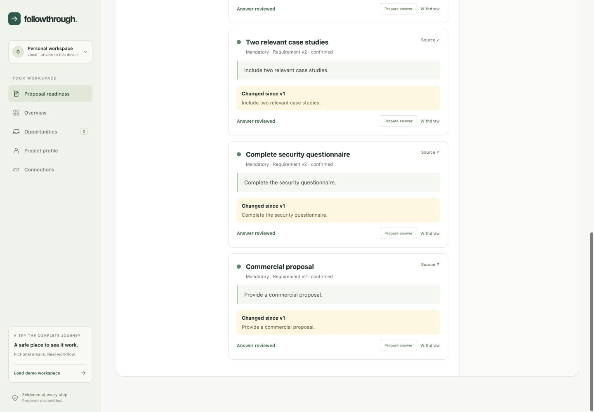

# FollowThrough

A local proposal-readiness assistant for small software agencies. It keeps client requirements beside their sources, matches approved company evidence, and reopens review when the client changes the brief.

**Hackathon MVP, not a production service.** Built with Nebius Token Factory and `nvidia/NVIDIA-Nemotron-3-Nano-30B-A3B`. No customer impact or contract-win claims have been measured.

[Watch the 2:30 demo](https://www.youtube.com/watch?v=TGrqRwF3qm0) · [Download the test build](https://github.com/gowtham66867/followthrough/releases/tag/v0.2.0)



## The business problem

A proposal owner reconciles an RFP, clarification emails, company case studies and amendments manually. A missed attachment can make a proposal incomplete; an unsupported promise can create delivery risk. FollowThrough exposes those gaps before export.

## Start the test build

Python 3.11+ is required. The release ZIP includes the built frontend, so Node is optional for reviewers.

```sh
python3.11 -m venv .venv
.venv/bin/python -m pip install -r requirements.txt
.venv/bin/python run.py
```

Open **http://127.0.0.1:8787**. Use **Load guided demo** to explore a labelled fictional scenario without accounts or credits. This guided extraction is fixture-based and is not presented as live AI.

On Windows, use `.venv\Scripts\python.exe` instead of `.venv/bin/python`.

To build the frontend from source, use Node 22.12+:

```sh
npm --prefix frontend ci --ignore-scripts
npm --prefix frontend run build
```

## Test live NVIDIA inference

Copy `config.example.yaml` to `config.yaml`, select an available NVIDIA model, and set `NEBIUS_API_KEY` in the server environment. Alternatively, put supported secrets in `.data/credentials.json` with private file permissions. The launcher accepts `--credentials /private/path.json` and respects pre-existing environment values. Never commit this file.

```json
{"NEBIUS_API_KEY":"YOUR_OWN_KEY"}
```

Restart the app. In **Sources**, select an RFP and click **Analyze with NVIDIA**. Only that selected source and existing requirement titles are sent to Nebius. The app requests JSON; strict schemas and exact source quotations are checked before applying any result. Citation offsets are computed by code. Unknown, absent or ambiguous quotations fail closed.

`enable_thinking: false` was tested with Nemotron 3 Nano to avoid spending the response budget on reasoning. Other models may support different template options.

## Walk through the proposal journey

1. Load the fictional Northstar Customer Portal opportunity.
2. Inspect each requirement and source, then confirm the displayed requirements.
3. Select **Match approved evidence**. These are deterministic evidence excerpts, not invented AI prose.
4. Open each answer, check relevance and select **I reviewed this answer** before saving.
5. Confirm the sourced deadline. Open package review, approve the exact revision, and export.
6. Add the fictional client amendment. It changes delivery, adds a security attachment and asks about certification. The previous approval is invalidated and the affected answer needs review.
7. Confirm the changed requirements and deadline. Add missing company evidence and the attachment, then review answers. An unsupported certification claim blocks approval unless the owner records an explicit, auditable exception.
8. Approve the corrected revision and export again.
9. Report external submission. Import a receipt source naming the opportunity and confirming receipt, then review submission evidence and acknowledgement separately.

A task marked done does not approve an answer. Approval does not submit anything externally. A receipt is human-reviewed evidence, not independent authentication of the sender.

## Documents and exports

Import PDF, DOCX, TXT, MD or EML, or paste selected email text. Files are limited to 3 MB and text to 80,000 characters. PDFs are limited to 25 text-readable pages. Unreadable pages require OCR, which is not implemented. Macros and embedded instructions are never executed.

The export ZIP contains a client-facing `proposal.docx`, separate internal review JSON, attachment manifest, and original uploaded attachment files. Pasted attachments export as text. Internal exceptions and source review notes stay out of the client-facing document.

## Validation

- 11 automated checks passed across the proposal and original email workflows in the development checkout.
- Six small, labelled fictional live NVIDIA examples passed schema, citation and keyword-based expected-requirement checks. This is a smoke evaluation, not a statistically meaningful accuracy estimate.
- Results, model usage and latency are in [submission/live-evaluation.json](submission/live-evaluation.json).
- Examples cover mandatory/optional classification, quantities, an amendment, an ambiguous deadline, an instruction-injection example, and commercial requirements.
- Original live experiments failed on extra fields, truncation and offsets. The revised path uses JSON output, non-thinking Nano inference and deterministic quotation anchoring. Broader testing remains necessary.

Run tests from a standalone release:

```sh
.venv/bin/python -m pip install -r requirements-dev.txt
sh scripts/run_tests.sh
```

In the Hermes development checkout, use its root `scripts/run_tests.sh` with the FollowThrough test paths instead. The starter CLI tests are additional development coverage and are not shipped in this standalone application.

## Privacy and boundaries

This release is **single-owner and local only**. It binds to loopback, enforces the configured Host/Origin, and requires a local session cookie for API access. It has no multi-tenant authentication and must not be exposed through a public tunnel or internet-facing proxy.

Sources, database and OAuth tokens are protected by filesystem permissions, not encryption at rest. No background telemetry is collected. API keys and provider bodies are not logged. SQLite writes are transactional. Original sources and approval history are preserved.

Use one server per data directory. Back up that directory with the server stopped. Do not share a real-data workspace as a demo.

## Optional Gmail connection

The original email workspace includes read-only Gmail OAuth. It requires your own Google OAuth client, Gmail API enabled, consent/testing configuration, and exact redirect URI `http://127.0.0.1:8787/api/gmail/callback`. Set `gmail_client_id` in config and `GOOGLE_CLIENT_SECRET` privately, then use Connections. This integration remains unverified with customer credentials. Proposal readiness works through document and pasted-email imports without Gmail.

## What this version does not establish

- No real customer interviews, adoption, revenue or time-saving measurements.
- No legal/commercial compliance guarantee or automated bid submission.
- No OCR, arbitrary spreadsheets or email-history disentangling.
- No automatic determination that a later message is authoritative; the user reviews amendments.
- Evidence matching is lexical and exact-excerpt based; it can miss relevant evidence or suggest irrelevant passages. Human review is required.
- Requirement omissions, paraphrase errors and unstable model-generated keys remain possible. Human requirement review is essential.
- Sources are selected and imported by the user; no continuous inbox monitoring.
- No production hosting, organization isolation or team collaboration.

## Architecture

React/Vite frontend, FastAPI, SQLite, bounded document parsers, persistent email jobs, and a small deterministic proposal orchestrator. NVIDIA interprets the selected client text; application code controls evidence checks, state, approval and exports. See [architecture](docs/ARCHITECTURE.md).

Original source-based design work was informed by [ARGUS](https://github.com/nithesh1705/argus-bfsi-compliance-intelligence) and [Maya](https://github.com/CodebyKumar/maya-voiceai-application). No source code or credentials were copied.

MIT licensed. Built as a standalone app; the Hermes provider and core are unchanged.
