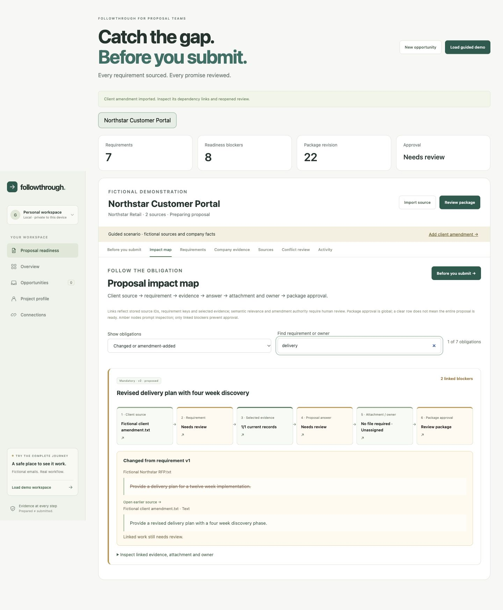

# FollowThrough

A local proposal-readiness assistant for small software agencies. It keeps client requirements beside their sources, matches approved company evidence, and reopens review when the client changes the brief.

**Hackathon MVP, not a production service.** Built with Nebius Token Factory and `nvidia/NVIDIA-Nemotron-3-Nano-30B-A3B`. No customer impact or contract-win claims have been measured.

[Watch the original 2:30 core-workflow demo](https://www.youtube.com/watch?v=TGrqRwF3qm0) · [Download the test build](https://github.com/gowtham66867/followthrough/releases/tag/v0.4.0)



## The business problem

A proposal owner reconciles an RFP, clarification emails, company case studies and amendments manually. A missed attachment can make a proposal incomplete; an unsupported promise can create delivery risk. FollowThrough exposes those gaps before export.

## Start the test build

Python 3.11+ is required. The release ZIP includes the built frontend, so Node is optional for reviewers.

```sh
python3.11 -m venv .venv
.venv/bin/python -m pip install -r requirements.txt
.venv/bin/python run.py
```

Open **http://127.0.0.1:8787**. Use **Load guided demo** to explore a labelled fictional scenario without accounts or credits. This guided extraction is fixture-based and is not presented as live AI.

On Windows, use `.venv\Scripts\python.exe` instead of `.venv/bin/python`.

To build the frontend from source, use Node 22.12+:

```sh
npm --prefix frontend ci --ignore-scripts
npm --prefix frontend run build
```

## Test live NVIDIA inference

Copy `config.example.yaml` to `config.yaml`, select an available NVIDIA model, and set `NEBIUS_API_KEY` in the server environment. Alternatively, put supported secrets in `.data/credentials.json` with private file permissions. The launcher accepts `--credentials /private/path.json` and respects pre-existing environment values. Never commit this file.

```json
{"NEBIUS_API_KEY":"YOUR_OWN_KEY"}
```

Restart the app. In **Sources**, select an RFP and click **Analyze with NVIDIA**. Only that selected source and existing requirement titles are sent to Nebius. The app requests JSON; strict schemas and exact source quotations are checked before applying any result. Citation offsets are computed by code. Unknown, absent or ambiguous quotations fail closed.

`enable_thinking: false` was tested with Nemotron 3 Nano to avoid spending the response budget on reasoning. Other models may support different template options.

## Semantic evidence, visual pages and deeper review

The optional settings in `config.example.yaml` were live-tested on this account on October 23, 2026:

| Purpose | Model | Invocation |
| --- | --- | --- |
| Requirement extraction | `nvidia/NVIDIA-Nemotron-3-Nano-30B-A3B` | Analyze a selected source |
| Semantic shortlist | `Qwen/Qwen3-Embedding-8B` | Find evidence with Nebius |
| Relevance assessment | `nvidia/NVIDIA-Nemotron-3-Nano-30B-A3B` | After the embedding shortlist |
| Page transcription | `nvidia/Nemotron-3.5-Super-VL` | Explicit visual import |
| Cited conflict review | `nvidia/nemotron-3-super-120b-a12b` | Conflict review tab |

Model availability can change. Set these model IDs explicitly in YAML and use your own Nebius key. The documented `Qwen/Qwen3-Reranker-8B` returned HTTP 404 on our account; the implemented reranking is NVIDIA **chat-based relevance assessment**, not the unavailable dedicated `/rerank` model. Failed live calls never switch to fixtures.

Semantic retrieval searches up to 64 non-overlapping 1,000-character passages from approved, unexpired evidence, then assesses the top eight. The UI shows candidate excerpts, model explanations and similarity. It does not overwrite reviewed answers or approve a candidate. Selecting a candidate inserts its complete approved evidence record; review it before saving. Search results become stale when the requirement or valid evidence changes. No vector database or hidden background indexing is used.

**Conflict review** is optional and on demand. It sends the opportunity's original RFP/amendment text, requirement state, deadline and approved company evidence to the configured reasoning model with thinking enabled. Output is limited to eight cited findings, not raw chain-of-thought. Exact source quotes are checked by code. A new review clears existing approval. Once used, unresolved findings and outdated reviews block approval/export. The owner can accept a risk with documented follow-up or dismiss a finding with a reason. This records a decision; it does not resolve a contractual ambiguity or override other readiness checks. Source, requirement, deadline and approved-evidence changes require a new review. Prior reviews and decisions remain auditable.

Three fictional live smoke cases passed: semantic search (~14.3 s), visual transcription (~1.8 s), and conflict review (~8.9 s) in the latest run. These are single observations, not service-level or accuracy claims. See [advanced evaluation](submission/advanced-live-evaluation.json). The original YouTube video demonstrates the v0.2 core workflow; new feature captures are included separately.

To repeat these paid, synthetic-only checks deliberately:

```sh
python scripts/validate_advanced.py --credentials /private/path/to/credentials.json
```

## Impact map and final review

**Before you submit** is the default proposal view. It groups deterministic blockers by source review, requirements, answers, evidence support, attachments, deadline and optional conflict review. Missing-input owners and documented exceptions are shown separately as advisory follow-ups. Every issue has a navigation target and next action; attachment actions preselect the required deliverable, owner actions open its task form, and deadline actions open the sourced date review. These checks are not a completeness, relevance or legal-compliance guarantee.

**Impact map** traces each requirement through its original source, selected evidence records, proposal answer, required attachment, task owner and global package approval. Filter changed/amendment-added obligations or search by requirement/owner. Changed quotations appear beside their earlier wording and preserve both source links. Pending unanalyzed amendments explicitly show that impact mapping is incomplete. Links are derived from stored identifiers and model-proposed requirement keys, not an independently verified causal graph. Human review still determines amendment authority and semantic relevance.

The map, action queue, approval, export and user-reported submission gate share the same backend readiness contract. Read-only projections do not change revisions or the package hash. An expired evidence record can block an old approval even when its content hash is unchanged. A completed owner task does not approve the answer or satisfy an attachment. A clear row does not approve the entire package.

The fictional browser walkthrough verified: prepare and review answers, approve revision 20, add an amendment, observe approval reopening at revision 22, inspect changed delivery wording, and open an attachment import preselected to the missing workbook. Screenshots show [approved review](submission/15-final-review-approved.png), [amendment impact](submission/16-amendment-impact-map.png) and [blocked review](submission/17-final-review-blocked.png). These are demonstration artifacts, not customer outcome measurements.

## Walk through the proposal journey

1. Load the fictional Northstar Customer Portal opportunity.
2. Inspect each requirement and source, then confirm the displayed requirements.
3. Select **Match by keywords (local)** for offline matching, or open **Prepare answer → Find evidence with Nebius** for semantic search and NVIDIA relevance review. Suggestions never change an answer until you choose a record.
4. Open each answer, check relevance and select **I reviewed this answer** before saving.
5. Confirm the sourced deadline. Open package review, approve the exact revision, and export.
6. Add the fictional client amendment. It changes delivery, adds a security attachment and asks about certification. The previous approval is invalidated and the affected answer needs review.
7. Confirm the changed requirements and deadline. Add missing company evidence and the attachment, then review answers. An unsupported certification claim blocks approval unless the owner records an explicit, auditable exception.
8. Approve the corrected revision and export again.
9. Report external submission. Import a receipt source naming the opportunity and confirming receipt, then review submission evidence and acknowledgement separately.

A task marked done does not approve an answer. Approval does not submit anything externally. A receipt is human-reviewed evidence, not independent authentication of the sender.

## Documents and exports

Import PDF, DOCX, TXT, MD or EML, or paste selected email text. Standard imports stay local and support up to 25 text-readable PDF pages. For scanned PDFs, table-heavy pages, PNG or JPEG, select **Read scanned pages and tables with Nebius vision**. This uploads rendered page images immediately, supports 1–6 pages, and requires you to compare and correct the transcription against every original page before analysis. Files are limited to 3 MB, text to 80,000 characters, images to 20 megapixels, and rendered pages to 1600 pixels on the longest side. Small text may be lost at that resolution; split or crop documents as needed. Visual quotations are grounded in the human-reviewed transcription, not independently verified pixels. Macros and embedded instructions are never executed.

The export ZIP contains a client-facing `proposal.docx`, separate internal review JSON, attachment manifest, and original uploaded attachment files. Pasted attachments export as text. Internal exceptions and source review notes stay out of the client-facing document.

## Validation

- 13 standalone automated tests cover the proposal and original email workflows, including two integrated HTTP/SQLite contracts for semantic retrieval, conflict dispositions and multipage visual imports. Two additional starter tests exist only in the development checkout.
- Six small, labelled fictional live NVIDIA examples passed schema, citation and keyword-based expected-requirement checks. This is a smoke evaluation, not a statistically meaningful accuracy estimate.
- Results, model usage and latency are in [submission/live-evaluation.json](submission/live-evaluation.json).
- Examples cover mandatory/optional classification, quantities, an amendment, an ambiguous deadline, an instruction-injection example, and commercial requirements.
- Original live experiments failed on extra fields, truncation and offsets. The revised path uses JSON output, non-thinking Nano inference and deterministic quotation anchoring. Broader testing remains necessary.

Run tests from a standalone release:

```sh
.venv/bin/python -m pip install -r requirements-dev.txt
sh scripts/run_tests.sh
```

In the Hermes development checkout, use its root `scripts/run_tests.sh` with the FollowThrough test paths instead. The starter CLI tests are additional development coverage and are not shipped in this standalone application.

## Privacy and boundaries

This release is **single-owner and local only**. It binds to loopback, enforces the configured Host/Origin, and requires a local session cookie for API access. It has no multi-tenant authentication and must not be exposed through a public tunnel or internet-facing proxy.

Sources, database and OAuth tokens are protected by filesystem permissions, not encryption at rest. No background telemetry is collected. API keys and provider bodies are not logged. SQLite writes are transactional. Original sources and approval history are preserved.

Use one server per data directory. Back up that directory with the server stopped. Do not share a real-data workspace as a demo.

## Optional Gmail connection

The original email workspace includes read-only Gmail OAuth. It requires your own Google OAuth client, Gmail API enabled, consent/testing configuration, and exact redirect URI `http://127.0.0.1:8787/api/gmail/callback`. Set `gmail_client_id` in config and `GOOGLE_CLIENT_SECRET` privately, then use Connections. This integration remains unverified with customer credentials. Proposal readiness works through document and pasted-email imports without Gmail.

## What this version does not establish

- No real customer interviews, adoption, revenue or time-saving measurements.
- No legal/commercial compliance guarantee or automated bid submission.
- Visual transcription can omit or misread content; human comparison is required. No arbitrary spreadsheet ingestion or email-history disentangling.
- No automatic determination that a later message is authoritative; the user reviews amendments.
- Local matching uses keywords. Optional semantic matching uses embeddings followed by NVIDIA chat relevance assessment; it can still miss evidence or misjudge relevance. Neither similarity nor model relevance is a calibrated confidence score.
- Requirement omissions, paraphrase errors and unstable model-generated keys remain possible. Human requirement review is essential.
- Sources are selected and imported by the user; no continuous inbox monitoring.
- No production hosting, organization isolation or team collaboration.

## Architecture

React/Vite frontend, FastAPI, SQLite, bounded document parsers, persistent email jobs, and a small deterministic proposal orchestrator. NVIDIA interprets the selected client text; application code controls evidence checks, state, approval and exports. See [architecture](docs/ARCHITECTURE.md).

Original source-based design work was informed by [ARGUS](https://github.com/nithesh1705/argus-bfsi-compliance-intelligence) and [Maya](https://github.com/CodebyKumar/maya-voiceai-application). No source code or credentials were copied.

MIT licensed. Built as a standalone app; the Hermes provider and core are unchanged.
